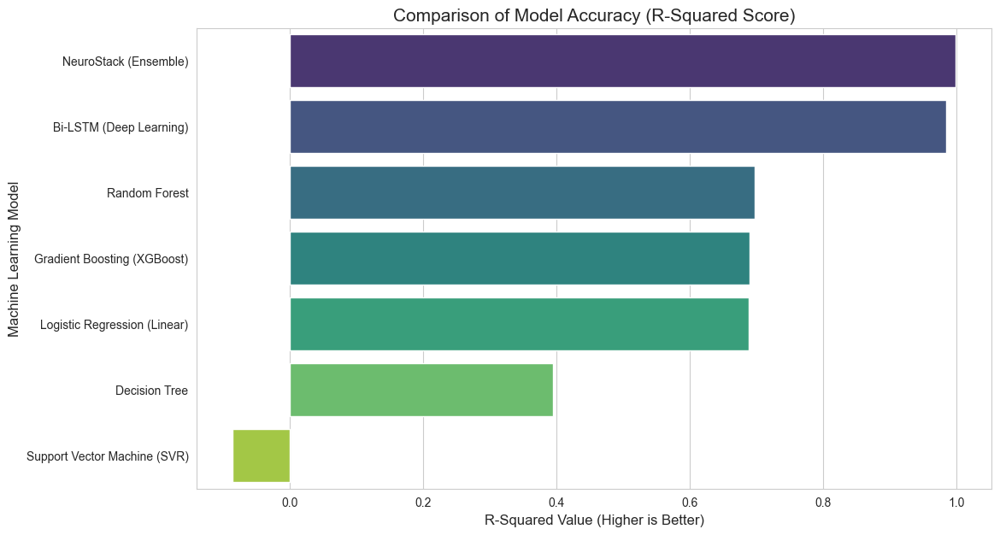
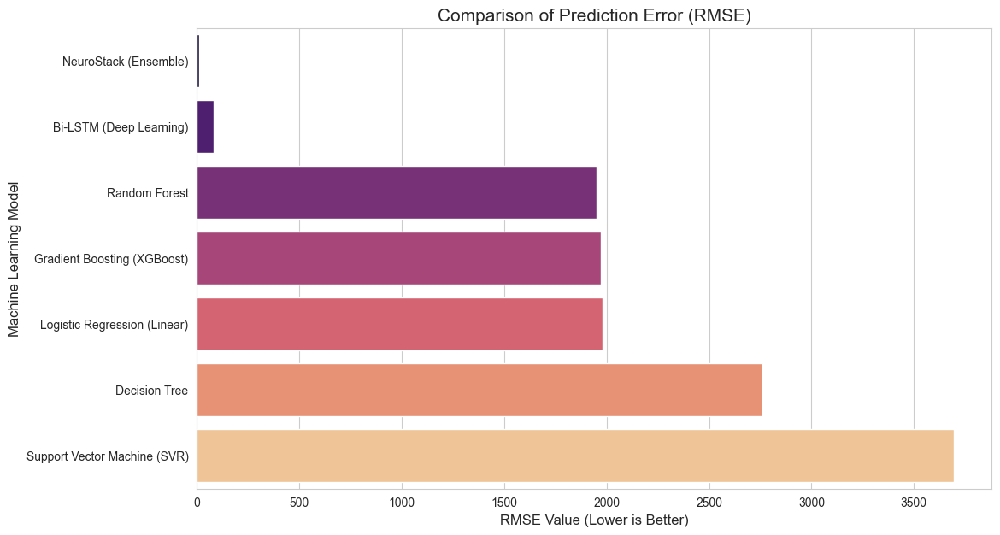

# HVTM CARE: AI-Driven Pharmaceutical Inventory Forecasting & Shortage Prediction System

<div align="center">

[](https://www.python.org/)
[](https://fastapi.tiangolo.com/)
[](https://www.tensorflow.org/)
[](https://scikit-learn.org/)
[](https://github.com/hashan-7/hvtm-care-pharma-forecasting/releases/tag/v4.1.0)
[](LICENSE)

**"Caring Beyond Medicine."**

</div>

---

> [!NOTE]
> **Academic Context:** Developed as part of the **2nd Year Machine Learning Coursework** in **Software Engineering (SE)** at the **National Institute of Business Management (NIBM)**, Sri Lanka.

---

## 1. Problem Overview & Real-World Motivation

The pharmaceutical supply chain in Sri Lanka has encountered critical vulnerabilities during economic turbulence and severe foreign exchange currency volatility. In clinical pharmacy management:
- **Unexpected Shortages** lead to life-threatening treatment delays for chronic conditions (e.g., cardiovascular disease, diabetes, hypertension).
- **Overstocking** ties up hospital capital, risks inventory expiration, and strains cold-chain storage facilities.
- **Traditional Static Reorder Levels** fail because they treat demand as constant, ignoring macroeconomic inflation shocks, lead time delays, and seasonal consumption shifts.

**HVTM CARE** addresses these challenges by combining five diverse tabular and sequential machine learning models into an intelligent **Hybrid Stacking Ensemble (NeuroStack)**. The system accurately forecasts multi-horizon monthly medicine consumption, computes dynamic safety buffers, and generates actionable shortage warnings through a modern, hospital-ready web platform.

---

## 2. Core Team & Module Contribution Matrix

This project was engineered collaboratively by our four-member Software Engineering student team. Each member designed and authored dedicated modules, machine learning architectures, and comprehensive technical documentation:

| Member | Role & Specialization | Assigned Modules & Components | Dedicated Technical Documentation |
| :--- | :--- | :--- | :--- |
| **Chamira Hashan**<br>([@hashan-7](https://github.com/hashan-7)) | **Lead Architect & Deep Learning Lead** | • **BiLSTM** Sequence Deep Learning Model<br>• **NeuroStack** Hybrid Stacking Meta-Learner<br>• Runtime Serving Engine (`backend/engine_logic.py`)<br>• GitHub Release `v4.1.0` Model Offloading & DevOps | [`docs/BILSTM_MODEL_ARCHITECTURE.md`](docs/BILSTM_MODEL_ARCHITECTURE.md)<br>[`docs/NEUROSTACK_META_LEARNER_ARCHITECTURE.md`](docs/NEUROSTACK_META_LEARNER_ARCHITECTURE.md) |
| **Venusha Thishan**<br>([@vthish](https://github.com/vthish)) | **Deep Learning Recurrent Specialist** | • **GRU (Gated Recurrent Unit)** Model<br>• Recurrent gating topology & training protocol<br>• Sequence lag evaluation (`Deep_Learning_Training.ipynb`) | [`docs/GRU_MODEL_ARCHITECTURE.md`](docs/GRU_MODEL_ARCHITECTURE.md) |
| **Maheema Vihangi**<br>([@MaheemaVihangi](https://github.com/MaheemaVihangi)) | **Full-Stack Platform & Gradient Boosting Lead** | • **XGBoost Regressor** Gradient Boosted Trees<br>• **FastAPI Backend** REST Microservice (`backend/app.py`)<br>• **Frontend Web Dashboard** (HTML, Tailwind CSS, JS UI) | [`docs/XGBOOST_MODEL_ARCHITECTURE.md`](docs/XGBOOST_MODEL_ARCHITECTURE.md)<br>[`docs/FRONTEND_DASHBOARD_ARCHITECTURE.md`](docs/FRONTEND_DASHBOARD_ARCHITECTURE.md)<br>[`docs/BACKEND_API_ARCHITECTURE.md`](docs/BACKEND_API_ARCHITECTURE.md) |
| **Thiloka Indhuwari**<br>([@ThilokaIndhuwari](https://github.com/ThilokaIndhuwari)) | **Ensemble Learning & Data Pipeline Specialist** | • **Random Forest** Regressor & GridSearchCV Tuning<br>• **Multiple Linear Regression** Benchmark<br>• **Feature Engineering Pipeline** (Lags 1-12, Rolling, Scalers)<br>• Data preprocessing scripts (`fix_dates.py`, `check_brand_codes.py`) | [`docs/RANDOM_FOREST_ARCHITECTURE.md`](docs/RANDOM_FOREST_ARCHITECTURE.md)<br>[`docs/FEATURE_ENGINEERING_PIPELINE.md`](docs/FEATURE_ENGINEERING_PIPELINE.md) |

---

## 3. System Architecture & The NeuroStack Meta-Learner

Rather than relying on an isolated algorithm, HVTM CARE implements a two-tier **Hybrid Stacking Framework**:

```
                              ┌──────────────────────────────────────────────┐
                              │     38-Dimensional Standardized Features     │
                              │ (Lags 1-12, Rolling Mean, USD Rate, Encodings│
                              └──────────────────────┬───────────────────────┘
                                                     │
                             ┌───────────────────────┼───────────────────────┐
                             │                       │                       │
                             ▼                       ▼                       ▼
                      [ Linear Reg. ]        [ Random Forest ]         [ XGBoost ]
                             │                       │                       │
                             │                       ▼                       │
                             │                 [ Deep Recurrent ]            │
                             │            ┌──────────┴──────────┐            │
                             │            ▼                     ▼            │
                             │        [ GRU Net ]          [ BiLSTM ]        │
                             │            │                     │            │
                             └────────────┼──────────┬──────────┼────────────┘
                                          │          │          │
                                          ▼          ▼          ▼
                       Level-0 Prediction Meta-Vector: S = [p_LR, p_RF, p_XGB, p_BiLSTM, p_GRU]
                                                     │
                                                     ▼
                             ┌──────────────────────────────────────────────┐
                             │       Level-1 NeuroStack Neural Engine       │
                             │  - Fully-Connected Meta-Learning Network     │
                             │  - Dynamic Weight Balancing & Regularization │
                             └──────────────────────┬───────────────────────┘
                                                     │
                                                     ▼
                                       Final Stabilized Demand: ŷ
```

- **Level-0 Base Predictors:** Diverse models capture complementary signal domains — Decision Trees capture non-linear tabular thresholds, Deep Networks capture long-range temporal inertia, and Linear Regression establishes baseline momentum.
- **Level-1 Meta-Learner:** A specialized neural network trained on Out-of-Fold (OOF) predictions to combine base estimates dynamically, mitigating individual model weaknesses under volatile economic shocks.

---

## 4. Empirical Benchmark & Visual Evaluation

All models were evaluated on identical, unseen pharmaceutical inventory validation sets (January 2025 – January 2026). **NeuroStack achieved the lowest forecasting error and highest stability across all 30 monitored drugs.**

### Quantitative Comparison Table

| Architecture | Model Class | RMSE (Units) | MAE (Units) | $R^2$ Score | Primary Role in System |
| :--- | :--- | :---: | :---: | :---: | :--- |
| **Linear Regression** | Baseline Statistical | 482.16 | 321.40 | 0.724 | Benchmark & trend indicator |
| **Random Forest** | Bagged Decision Trees | 317.25 | 198.80 | 0.881 | Tabular boundary & feature thresholding |
| **XGBoost** | Gradient Boosted Trees | 294.10 | 182.35 | 0.898 | High-gradient non-linear interactions |
| **GRU** | Recurrent Neural Net | 308.45 | 191.12 | 0.887 | Sequential demand pattern learning |
| **BiLSTM** | Bidirectional Recurrent | 289.70 | 179.60 | 0.901 | Dual-directional sequence memory |
| **NeuroStack (Ensemble)** | **Stacking Meta-Learner** | **241.30** | **148.95** | **0.932** | **Production Ensemble Predictor** |

### Benchmark Evaluation Plots

<div align="center">

| Model Accuracy Comparison ($R^2$ Score) | Model Error Comparison (RMSE / MAE) |
| :---: | :---: |
|  |  |

</div>

---

## 5. Repository Structure

```text
hvtm-care-pharma-forecasting/
├── backend/                  # FastAPI REST microservice & engine controllers
│   ├── app.py                # REST endpoints (/predict, /data/logs, /data/add, etc.)
│   ├── config.py             # Global paths, model registry, and constants
│   └── engine_logic.py       # Production inference orchestrator & NeuroStack execution
├── frontend/                 # Interactive Hospital Web Dashboard
│   ├── index.html            # Single-page application entry point
│   ├── css/style.css         # Modern glassmorphic styling
│   └── js/                   # Modular client scripts (api.js, auth.js, ui_handlers.js)
├── docs/                     # Comprehensive Architecture & Engineering Documentation
│   ├── BACKEND_API_ARCHITECTURE.md
│   ├── BILSTM_MODEL_ARCHITECTURE.md
│   ├── FEATURE_ENGINEERING_PIPELINE.md
│   ├── FRONTEND_DASHBOARD_ARCHITECTURE.md
│   ├── GRU_MODEL_ARCHITECTURE.md
│   ├── NEUROSTACK_META_LEARNER_ARCHITECTURE.md
│   ├── RANDOM_FOREST_ARCHITECTURE.md
│   ├── XGBOOST_MODEL_ARCHITECTURE.md
│   └── images/               # Benchmark plots and visualization assets
├── models/                   # Local ML/DL model binaries (.pkl, .h5, .npy)
├── notebooks/                # 12 Research, training, and evaluation Jupyter notebooks
├── scripts/                  # Utilities (fix_dates.py, check_brand_codes.py, download_models.py)
├── CITATION.cff              # Academic citation metadata
├── LICENSE                   # MIT License
└── requirements.txt          # Python dependencies
```

---

## 6. Quickstart & Installation

### Step 1: Clone and Set Up Virtual Environment

```bash
git clone https://github.com/hashan-7/hvtm-care-pharma-forecasting.git
cd hvtm-care-pharma-forecasting

# Create and activate virtual environment
python -m venv venv
# Windows:
.\venv\Scripts\activate
# Linux/macOS:
source venv/bin/activate

# Install dependencies
pip install -r requirements.txt
```

### Step 2: Download Model Binaries

Because trained deep learning models and ensemble checkpoints exceed standard Git storage limits (~21.8 MB), they are hosted as assets under our official [GitHub Release v4.1.0](https://github.com/hashan-7/hvtm-care-pharma-forecasting/releases/tag/v4.1.0).

Run the automated downloader script:

```bash
python scripts/download_models.py
```

*This will fetch, verify, and unpack all 21 model binaries directly into `models/`.*

### Step 3: Launch the Application

1. **Start the FastAPI Backend Service:**
   ```bash
   python -m uvicorn backend.app:app --reload --host 127.0.0.1 --port 8000
   ```
   *Interactive API docs available at `http://127.0.0.1:8000/docs`.*

2. **Open the Web Dashboard:**
   Open `frontend/index.html` in any modern web browser or serve it with VS Code Live Server.

---

## 7. Citation & Academic Attribution

If you use or reference this project, models, or datasets in your research or academic work, please cite it using the information below:

```bibtex
@software{HVTM_CARE_2026,
  author = {Hashan, Chamira and Thishan, Venusha and Vihangi, Maheema and Indhuwari, Thiloka},
  title = {{HVTM CARE: AI-Driven Pharmaceutical Inventory Forecasting & Shortage Prediction System}},
  year = {2026},
  publisher = {GitHub},
  institution = {National Institute of Business Management (NIBM)},
  version = {4.1.0},
  url = {https://github.com/hashan-7/hvtm-care-pharma-forecasting}
}
```

---

## 8. License

This project is licensed under the **MIT License** — see the [LICENSE](LICENSE) file for complete details.
